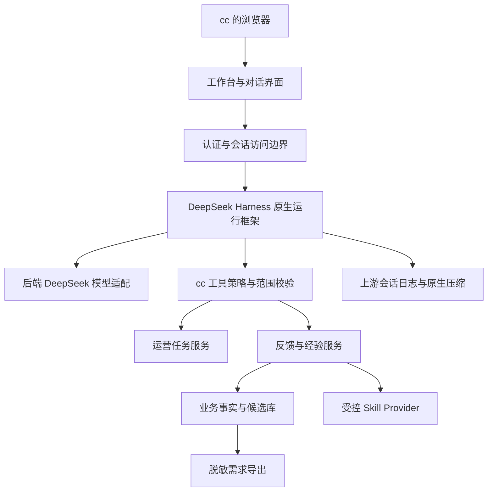

# P0 架构草案

版本：0.1.0｜状态：待 R0 技术验证和契约冻结

需求依据：[业务需求](../docs/product/REQUIREMENTS.zh.md)。上游事实依据：[Harness 调研](../docs/references/deepseek-harness.md)。本文件的模块名和选型建议尚不是已经运行的架构。

## 1. 复用与边界

基于用户指定的官方 DeepSeek Harness，通过 profile / bundle / Cordis plugin 扩展。优先保留原生会话、模型路由、工具执行、持久化、压缩和 Skill 注册；cc 的页面、业务任务、反馈及经验管理由项目插件承担。不另造 Agent loop 或多个模型服务。

P0 拟采用单主机 Node.js/TypeScript 运行时；扩展 UI 复用上游 React 与样式机制。业务存储建议 SQLite 事务库，必须在 R0 验证驱动、并发写和备份方式；若上游已有满足要求的可支持存储 seam，优先适配。上游会话存储与业务存储各有单一所有者，不直接改写对方文件。

本地已观察 Node 24.19.0、Python 3.12.4、Git 2.53.0；没有安装 Harness/pnpm。所读上游根清单要求 Node >=24.9.0、pnpm 11.28.5。服务器运行时与可用资源尚未复查。构建优先在开发机/CI，2核4GB服务器只运行验证过的产物；是否足够必须实测。

## 2. 代码组织建议

只有开始实现时才创建模块：

| 路径建议 | 职责 | 依赖 |
| --- | --- | --- |
| packages/cc-workbench/ | 问候、能力卡片、任务和反馈视图 | 业务契约、上游 UI 扩展 |
| packages/cc-operations/ | 人工任务、活动元数据和确定性规则 | 业务存储 |
| packages/cc-learning/ | 捕获、归并、压缩、候选 Skill、需求导出 | 原生会话事件、业务存储 |
| packages/cc-harness-adapter/ | 事件接入、工具权限、Skill Provider、配置 | 固定版本上游 seam |
| config/ / deploy/ | 非敏感 profile overlay 与后续部署配置 | 固定产物、外部配置 |
| tests/ | 合成用例、集成、E2E 与恢复验证 | 明确版本与隔离数据 |

上游源码调研放仓库外。本项目优先使用锁定版本的包与插件；若欢迎区/布局无法通过公开扩展达到目标，R0 用最小原型判断，再记录“受控上游 patch”或小范围 fork 的成本。不能在未验证 UI seam 时宣称零修改可实现。引入上游代码保留 MIT 与第三方声明，不把整个上游复制进项目淹没业务代码。

## 3. 入口与任务交互

问候由本地确定性模板提供，第一条助手内容始终先问好，不等待模型。功能目录来自服务端能力状态：`available / needs_data / needs_permission / unavailable / planned`。每次打开显示一次入口问候，不反复向已有对话写入重复系统消息。

提示例子仅引用实际可执行能力；模型离线时基础导航、任务列表、已有反馈/记忆仍可查看。错误提示有安全错误码与 requestId，不能显示密钥、服务器路径或模型原始内部异常。

P0 最小任务为内部持久化草稿：标题、类型、站点时区、到期时刻、相关链接引用和状态。区分运营任务完成与模型文字“完成”。记录任务不暗示已经排期提醒或执行 Amazon 操作。活动实际生效仍由 cc 核验；完整调度是后续工作。

## 4. 工具与访问控制

部署面向 cc，不能将通用开发环境的 shell、任意文件读写、插件安装、源码修改和凭据管理直接开放给运营会话。P0 使用显式最小组合和服务端工具白名单；隐藏按钮不等于隔离。所有调用在执行层校验身份、workspace/store scope、参数和幂等键，Skill 和模型不能绕过。

P0 只允许内部任务/反馈/记忆/候选的受控写入。导入文件、外部内容、历史摘要和生成 Skill 都作为数据处理，不是扩大权限的指令。自动提炼失败不影响主对话与业务事实落盘。

初期单使用者、单 workspace；每条数据仍带 owner/workspace 和可选店铺/站点范围，不依赖前端过滤。P0 不实现多租户，但要有两个隔离 scope 的负向用例。

## 5. 持久化与异步学习

原始业务事件先事务落盘，再用 outbox 派生学习任务。唯一键由事件 ID、派生类型和算法版本组成；断点按已提交序号推进。失败重试、进程中断和模型重复输出不得产生重复反馈或 Skill 版本。

原生会话压缩控制模型上下文体积，产品学习则将相关来源提炼成结构化事实和可复用流程。两者独立：压缩成功不等于长期业务学习成功，学习也不能回写上游日志破坏其配对和重放语义。详见[自适应规格](adaptive-learning.md)。

运行时事实、会话、附件和生成 Skill 存仓库外；Git 只保存合成示例、规格、代码、经明确授权的脱敏需求和证据索引。产品自动导出写入仓库外审阅包，用户授权更新需求文档后才提交代码仓库。

## 6. 配置、运行与发布

模型 Key 仅供后端读取，前端和业务会话不能获取。R0 核实可用模型 ID、工具调用、超时/限额与真实返回，不硬编码旧模型别名。超时、取消、429、上下文溢出均有限重试和可见状态，不产生虚假的任务成功。

未来部署优先固定产物 + 最小反向代理/容器组合；具体方式由 R0 容量与上游启动验证确定。Harness 的 Host fence、launch token 和 Cookie 行为需按固定版本实际验证；公网 HTTPS、WebSocket、会话鉴权、静态资源和业务 API 一起验收。管理/插件安装能力不向 cc 暴露。

备份覆盖上游会话、业务库、Skill 版本与撤销记录，并能在隔离目录恢复。升级前备份数据，回退代码与恢复数据分别验证。观察 CPU/内存、磁盘、请求/学习失败率、队列积压和模型用量；指标不含高基数业务字段或原文。发布记录源码 SHA、上游 SHA、锁文件/产物哈希与数据版本。
